# ONE MORE USE ♻️
## COMPLETE SOFTWARE ENGINEERING SYSTEM REPORT

---

## Title Page

Project Title: ONE MORE USE ♻️ – AI-Based Reuse and Community Sharing Platform

Type: Full-Stack Capstone Project Report

Prepared for: Academic Submission / University Evaluation

Prepared by: [Placeholder – Student Name]

Department: [Placeholder – Department Name]

College: [Placeholder – College / University Name]

Guide: [Placeholder – Faculty Guide Name]

Date: 2026-11-17

---

## Certificate Placeholder

This document is submitted in partial fulfillment of the requirements for the degree / course.

Certificate details to be filled by the institution: [Placeholder]

---

## Declaration Placeholder

I declare that the work presented in this report is my own and has not been submitted elsewhere.

Declaration details to be filled by the student: [Placeholder]

---

## Acknowledgement Placeholder

The author acknowledges the support of the faculty and project guide. [Placeholder]

---

## Abstract

One More Use is a community-driven reuse platform designed to reduce waste by helping people reuse, exchange, or redistribute useful items rather than discard them. The repository implements a web application with a browser-based frontend, a Java Spring Boot backend, and a MySQL relational database. The application allows users to register, log in, upload an item image, receive five practical reuse suggestions, and list items for free or exchange. Other users can browse and search available items, send requests, and receive owner responses. The backend uses Spring Data JPA for persistence, BCrypt for password hashing, and centralized exception handling for validation and business-rule errors.

This report documents the implemented features, system architecture, database design, API behavior, testing status, and operational considerations based directly on the repository source code. It also clearly distinguishes implemented functions from proposed future features such as real machine-learning-based object recognition and stronger token-based authentication.

---

## Table of Contents

1. Chapter 1 – Introduction
2. Chapter 2 – Software Requirements Specification (SRS)
3. Chapter 3 – System Analysis
4. Chapter 4 – System Design Documentation (SDD)
5. Chapter 5 – Database Design
6. Chapter 6 – UML Diagrams
7. Chapter 7 – Data Flow Diagrams
8. Chapter 8 – System Architecture Diagrams
9. Chapter 9 – Implementation Documentation
10. Chapter 10 – API Documentation
11. Chapter 11 – Software Testing Documentation
12. Chapter 12 – Results and Discussion
13. Chapter 13 – Conclusion and Future Scope
14. Chapter 14 – Additional Technical Documentation

---

## List of Figures

1. Figure 1: Chen ER Diagram (Chen notation) for Users, Items, and Item Requests
2. Figure 2: High-Level Architecture Diagram
3. Figure 3: Frontend-Backend-Database Architecture Diagram
4. Figure 4: DFD Level 0 Context Diagram
5. Figure 5: DFD Level 1 Detailed Flow Diagram
6. Figure 6: DFD Level 2 Item Listing / Request Flow
7. Figure 7: Use Case Diagram
8. Figure 8: Class Diagram
9. Figure 9: Activity Diagram
10. Figure 10: Sequence Diagram for Registration
11. Figure 11: Component Diagram
12. Figure 12: Deployment Diagram
13. Figure 13: State Machine Diagram
14. Figure 14: Screenshot Placeholder – Login Screen
15. Figure 15: Screenshot Placeholder – Browse Screen
16. Figure 16: Screenshot Placeholder – Request Management Screen

---

## List of Tables

1. Table 1: Functional Requirements Summary
2. Table 2: Non-Functional Requirements Summary
3. Table 3: User Table Specification
4. Table 4: Item Table Specification
5. Table 5: Item Request Table Specification
6. Table 6: API Endpoint Summary
7. Table 7: Test Case Summary
8. Table 8: Requirements Traceability Matrix
9. Table 9: Data Dictionary Summary
10. Table 10: Test Execution Status Summary

---

## List of Abbreviations and Glossary

- API – Application Programming Interface
- CSS – Cascading Style Sheets
- DTO – Data Transfer Object
- JPA – Java Persistence API
- JSON – JavaScript Object Notation
- JS – JavaScript
- ML – Machine Learning
- MySQL – Relational database management system
- REST – Representational State Transfer
- SDD – System Design Document
- SRS – Software Requirements Specification
- SQL – Structured Query Language
- UI – User Interface
- UX – User Experience

Glossary:
- Item – A reusable object listed for giveaway or exchange
- Item Request – A user’s request to obtain an item
- Reuse Idea – A suggested repurposing concept for an item
- Owner – The user who posted an item
- Requester – The user who submits a request

---

# Chapter 1 – Introduction

## 1.1 Project Overview

One More Use is a full-stack reuse-sharing platform created for a college project context. The platform encourages sustainable consumption by allowing people to give away or exchange items they no longer need, instead of discarding them. The repository contains a working implementation with a browser-based frontend, a Java Spring Boot backend, and a MySQL database.

## 1.2 Background

The project addresses the real-world issue of household waste and underutilized items. Many objects remain usable but are thrown away due to lack of easy local sharing channels. The app provides a simple community-based method for reuse and exchange.

## 1.3 Problem Statement

The project aims to solve the problem of unnecessary disposal of useful objects. There is a need for a lightweight platform where users can upload an item, understand possible reuse ideas, and exchange or give away items to others in nearby communities.

## 1.4 Objectives

- Allow users to register and authenticate securely.
- Support item upload with optional image attachment.
- Generate reuse and repurposing suggestions for objects.
- Allow users to list items for free or exchange.
- Enable item discovery and search.
- Support request submission and owner-side response.
- Display profile statistics based on real database data.

## 1.5 Scope

The implemented scope includes user lifecycle, item listing, item request workflow, and rule-based reuse analysis. The code does not include a verified external AI or computer vision system; the suggestion engine is rule-based and keyword-driven.

## 1.6 Motivation

The project is motivated by sustainability, environmental awareness, community sharing, and practical reuse practices. It is designed as a student-friendly and demonstrable application with realistic workflows.

## 1.7 Existing System

The repository does not contain an earlier legacy system; the project is a greenfield full-stack application. The current system includes a front-end SPA and a Spring Boot backend with persistent storage in MySQL.

## 1.8 Proposed System

The implemented system has the following components:

- Frontend: HTML, CSS, JavaScript
- Backend: Java 17 + Spring Boot 3.2.5
- Database: MySQL 8.0+
- Persistence: Spring Data JPA + Hibernate
- Image handling: multipart file storage in uploads directory
- Security: BCrypt hashing for passwords

## 1.9 Advantages

- Simple and understandable architecture
- Local deployment with familiar technologies
- Real item and request management using database persistence
- Clear separation between frontend, backend, and database
- Extensible structure for future AI or cloud enhancements

## 1.10 Feasibility Study

### Technical Feasibility

The project is technically feasible because the repository already contains a working backend, frontend, and database design. Java, Maven, Spring Boot, and MySQL are all configured and used in code.

### Economic Feasibility

It is cost-effective because it uses open-source software and standard tools.

### Operational Feasibility

The project is operationally feasible because its workflows are simple and can be demonstrated through a browser-based UI and an API layer.

### Schedule Feasibility

The implementation is feasible within an academic project timeline because the modules map directly to a single, cohesive platform.

---

# Chapter 2 – Software Requirements Specification (SRS)

## 2.1 Purpose and Scope

The purpose of this SRS is to document the functional and non-functional requirements that are actually implemented in the repository. The system scope includes user registration, authentication, object upload, reuse suggestions, item listing, search, request management, and profile statistics.

## 2.2 Product Perspective

The product is a standalone web application that communicates with a backend REST API. The frontend is independent from the backend and does not depend on a framework such as React or Angular.

## 2.3 Product Functions

- User registration
- User login
- Password hashing and verification
- Item image upload
- Object analysis and reuse recommendations
- Item listing for free or exchange
- Item search and discovery
- Request creation and status update
- Profile statistics dashboard

## 2.4 User Classes

### End User
A user who registers, browses, posts items, and sends requests.

### Item Owner
A user who posts an item and can accept or reject incoming requests.

### Requester
A user who submits a request for an item listed by another owner.

## 2.5 Operating Environment

- Operating system: Windows, Linux, or macOS
- Java: 17+
- Maven: configured
- MySQL: 8.0+
- Browser: modern web browser with JavaScript enabled
- Backend port: 8080

## 2.6 Functional Requirements

| Requirement ID | Requirement | Verification Status |
|---|---|---|
| FR-01 | The system shall allow a new user to register with name, email, password, and location. | Implemented |
| FR-02 | The system shall validate that the email address is unique. | Implemented |
| FR-03 | The system shall hash passwords using BCrypt before storing them. | Implemented |
| FR-04 | The system shall allow an existing user to log in with email and password. | Implemented |
| FR-05 | The system shall validate login credentials against the stored hash. | Implemented |
| FR-06 | The system shall allow an authenticated user to upload an item image and metadata. | Implemented |
| FR-07 | The system shall store uploaded images in the configured uploads directory. | Implemented |
| FR-08 | The system shall allow an item to be listed as FREE or EXCHANGE. | Implemented |
| FR-09 | The system shall generate up to five reuse suggestions for a described object. | Implemented |
| FR-10 | The system shall search items by title, description, category, or location. | Implemented |
| FR-11 | The system shall allow users to view item details. | Implemented |
| FR-12 | The system shall allow a requester to submit an item request. | Implemented |
| FR-13 | The system shall prevent duplicate requests for the same item by the same user. | Implemented |
| FR-14 | The system shall prevent a user from requesting their own item. | Implemented |
| FR-15 | The system shall allow the item owner to accept or reject a request. | Implemented |
| FR-16 | The system shall allow users to view incoming and outgoing requests. | Implemented |
| FR-17 | The system shall provide profile statistics such as posted, given, received, and active requests. | Implemented |

## 2.7 Non-Functional Requirements

| Requirement ID | Requirement | Details |
|---|---|---|
| NFR-01 | Performance | API responses are expected to be quick for local desktop usage and small-to-medium data sets. |
| NFR-02 | Reliability | Validation and centralized exception handling reduce unexpected runtime failures. |
| NFR-03 | Availability | The system is designed for local deployment environments with MySQL and Spring Boot running. |
| NFR-04 | Security | BCrypt password hashing, validation, and ownership checks are implemented. |
| NFR-05 | Usability | A simple single-page workflow reduces complexity for end-users. |
| NFR-06 | Maintainability | The application is separated into controllers, services, repositories, DTOs, and entities. |
| NFR-07 | Scalability | The architecture supports additional features and modules without major redesign. |
| NFR-08 | Compatibility | The frontend works in standard browsers; backend works with Java and MySQL. |
| NFR-09 | Data Integrity | Database constraints and validation aim to maintain correct relationships. |
| NFR-10 | Privacy | User data is kept in the local database and not exposed in this report. |

## 2.8 Hardware Requirements

- Standard laptop or desktop computer
- Min 4 GB RAM (practical minimum)
- Minimum 2 GB free storage for project files and uploads
- Internet connectivity only if external tools or dependencies are used

## 2.9 Software Requirements

- Java 17 or later
- Maven
- MySQL Server 8.0+
- Modern browser with JavaScript enabled
- IDE such as IntelliJ IDEA, Eclipse, or VS Code

## 2.10 External Interface Requirements

- REST endpoints served over HTTP
- JSON-based request and response payloads
- Multipart form-data support for image upload requests
- Browser fetch API calls from the frontend to the backend

## 2.11 System Constraints

- There is no verified real AI model or third-party vision API in the source code.
- Frontend session data is stored in browser localStorage for demonstration simplicity.
- MySQL must be active for backend startup.
- The app is designed for local or campus demonstration environments rather than full enterprise deployment.

## 2.12 Assumptions and Dependencies

- MySQL service is installed and running.
- Application.properties contains valid database credentials.
- The project is executed from the repository workspace.
- Files are stored under the project directory and uploads folder.

## 2.13 Acceptance Criteria

The following acceptance criteria are directly aligned with the implemented functionality:

- A user can register successfully with valid data.
- A user can sign in with valid credentials.
- The system prevents duplicate email registrations.
- The user can upload an item and its image.
- The backend returns reuse idea suggestions.
- A user can list an item as FREE or EXCHANGE.
- A request can be created for an available item that is not owned by the requester.
- The owner can accept or reject a request.
- User stats reflect the actual counts of posted, given, received, and active items.

---

# Chapter 3 – System Analysis

## 3.1 Existing System Analysis

The existing project is a complete but demonstrative system. It includes essential user, item, and request flows. There is no previous system to replace; the application is implemented directly in the repository as a new application.

## 3.2 Proposed System Analysis

The proposed system is structured around a user flow that begins with account creation and authentication, followed by item upload or analysis. The app then allows item discovery, request management, and profile analytics.

## 3.3 Functional Analysis

The application functions are grouped into several modules:

- Authentication module
- Object analysis and suggestion engine
- Item management module
- Search and browse module
- Request lifecycle module
- User stats module

## 3.4 User Roles

### User Role 1 – General User
Performs login, signup, upload, browse, and request actions.

### User Role 2 – Item Owner
Posts items, manages requests, and accepts or rejects them.

### User Role 3 – Requester
Sends requests and tracks their outgoing requests.

## 3.5 System Workflow

1. User registers or logs in.
2. User uploads an item or enters description.
3. Backend evaluates the item using a rule-based suggestion engine.
4. Item is listed for free or exchange.
5. Other users search and request the item.
6. Owner responds with ACCEPTED or REJECTED.
7. Profile statistics update according to actual database state.

## 3.6 Detailed Use Case Specifications

### Use Case 1: User Registration
- Use Case ID: UC-01
- Actor: User
- Preconditions: User is not already registered.
- Main Flow: Enter details -> backend validates -> hash password -> save user -> return success.
- Alternative Flow: Duplicate email -> return error.
- Postconditions: User profile is created.

### Use Case 2: User Login
- Use Case ID: UC-02
- Actor: User
- Preconditions: User already exists.
- Main Flow: Submit email and password -> compare hash -> return token and user info.
- Alternative Flow: invalid credentials -> return unauthorized response.
- Postconditions: User is authenticated in session state.

### Use Case 3: Upload Item
- Use Case ID: UC-03
- Actor: Logged-in User
- Preconditions: User account exists.
- Main Flow: Enter metadata and optional image -> backend validates -> save item -> return item response.
- Alternative Flow: invalid type/size -> error message.
- Postconditions: item appears in the item catalog if available.

### Use Case 4: Generate Reuse Ideas
- Use Case ID: UC-04
- Actor: Logged-in User
- Preconditions: Description or object keyword is available.
- Main Flow: Send object text to backend -> engine matches keywords -> return five suggestions.
- Alternative Flow: unknown object -> generic suggestions are returned.
- Postconditions: suggestions are displayed in the frontend.

### Use Case 5: Item Listing
- Use Case ID: UC-05
- Actor: User
- Preconditions: User is authenticated.
- Main Flow: Create item listing with location and exchange type -> backend saves item.
- Alternative Flow: missing title/description -> validation error.
- Postconditions: item becomes visible to other users.

### Use Case 6: Item Search
- Use Case ID: UC-06
- Actor: User
- Preconditions: at least one item exists.
- Main Flow: Search query -> repository filters available items -> returns list.
- Alternative Flow: no matches -> empty result message.
- Postconditions: user sees matching results.

### Use Case 7: Item Request Submission
- Use Case ID: UC-07
- Actor: Requester
- Preconditions: Item exists and is available; requester is not owner.
- Main Flow: Create request message -> backend validates -> save request -> return request details.
- Alternative Flow: duplicate or self-request -> error.
- Postconditions: owner receives request.

### Use Case 8: Request Acceptance/Rejection
- Use Case ID: UC-08
- Actor: Owner
- Preconditions: Request exists for owner’s item.
- Main Flow: Owner updates request status to ACCEPTED or REJECTED.
- Alternative Flow: not owner -> unauthorized error.
- Postconditions: status is persisted.

### Use Case 9: View User Statistics
- Use Case ID: UC-09
- Actor: User
- Preconditions: User exists.
- Main Flow: Request stats endpoint -> compute counts -> return values.
- Alternative Flow: no records -> zeros returned.
- Postconditions: profile displays statistics.

## 3.7 Feasibility

### Technical Feasibility
The project is supported by actual source code and layered architecture. Components are implemented and connected.

### Economic Feasibility
Low cost because it uses open-source tools and standard web technologies.

### Operational Feasibility
The project is feasible in local college or classroom deployment scenarios.

---

# Chapter 4 – System Design Documentation (SDD)

## 4.1 System Architecture

The application follows a classic three-layer architecture: frontend, backend, and database. The frontend communicates to the backend through REST APIs. The backend handles business logic and persists data in MySQL using JPA repositories.

## 4.2 Architectural Design

The architecture is modular but simple:

- Presentation Layer: frontend files
- Application Layer: controllers and services
- Data Access Layer: repositories and JPA entities
- Persistence Layer: MySQL tables and uploads directory

## 4.3 Frontend Design

The frontend is a single-page application implemented in HTML, CSS, and JavaScript. It contains screens for login, dashboard, upload, analysis, nearby listings, item details, requests, and profile. The frontend uses fetch API calls to `/api/*` endpoints and stores session data in localStorage.

## 4.4 Backend Design

The backend is built with Spring Boot and organized into:

- `controller` — REST endpoints
- `service` — business logic
- `entity` — persistent domain classes
- `dto` — data transfer structures
- `repository` — JPA interfaces
- `config` — CORS, resource handling, exception handling

## 4.5 Database Design

The database is relational and contains: `users`, `items`, and `item_requests`. Foreign keys enforce referential integrity. This design supports user ownership of items, item lists, and request tracking.

## 4.6 Module Design

The following modules are present:

- Authentication module
- Item management module
- Reuse suggestion module
- Request workflow module
- User stats module

## 4.7 Component Design

The key components are:

- `AuthController` for user auth
- `ItemController` for listing and search operations
- `ReuseIdeaController` for analysis endpoints
- `ItemRequestController` for request processing
- `UserController` for profile endpoints
- `UserService`, `ItemService`, `ItemRequestService`, `ReuseIdeaService`

## 4.8 Interface Design

The application uses JSON for most API communication and multipart form-data for item creation with image uploads. This is explicitly reflected in the backend endpoint design and frontend fetch logic.

## 4.9 Security Design

The application includes:

- BCrypt password hashing
- Ownership checks before request status updates
- Input validation through `@Valid`
- CORS configuration for browser API access

## 4.10 Deployment Design

A typical deployment is:

- Frontend runs in a browser or static host
- Backend runs as a Spring Boot app on port 8080
- MySQL server runs locally and contains the schema
- Uploads directory stores files for item images

## 4.11 Error Handling

The project includes a centralized `GlobalExceptionHandler` that returns structured JSON error responses for invalid arguments, validation errors, and general runtime exceptions.

---

# Chapter 5 – Database Design

## 5.1 Database Overview

The project uses MySQL. The schema defines three main tables:

- `users`
- `items`
- `item_requests`

The SQL scripts create and seed the database, showing the actual relationship model of the application.

## 5.2 Entity Identification

The JPA entity classes are:

- `User`
- `Item`
- `ItemRequest`

These entities map directly to the MySQL tables.

## 5.3 Entity Attributes

### User
- `id`
- `name`
- `email`
- `passwordHash`
- `location`
- `createdAt`

### Item
- `id`
- `owner`
- `title`
- `description`
- `category`
- `itemCondition`
- `approxSize`
- `location`
- `imageUrl`
- `emoji`
- `exchangeType`
- `preferredExchangeItem`
- `isAvailable`
- `createdAt`

### ItemRequest
- `id`
- `item`
- `requester`
- `owner`
- `message`
- `status`
- `createdAt`
- `updatedAt`

## 5.4 Primary Keys

- `users.id`
- `items.id`
- `item_requests.id`

## 5.5 Foreign Keys

- `items.owner_id` -> `users.id`
- `item_requests.item_id` -> `items.id`
- `item_requests.requester_id` -> `users.id`
- `item_requests.owner_id` -> `users.id`

## 5.6 Relationships

- User posts many items: 1:N
- Item belongs to one owner: N:1
- Item has many requests: 1:N
- User can request many items: 1:N
- User can own many requests: 1:N

## 5.7 Cardinality and Participation

- One `user` can create zero or many `items`.
- One `item` is linked to exactly one `user` owner.
- One `item` may have zero or many `item_requests`.
- One `user` can send zero or many `item_requests` as requester.
- One `user` can receive zero or many `item_requests` as owner.

## 5.8 Referential Integrity

The database uses foreign keys with cascade deletion on some relations. This ensures item records and requests are tied to valid users and valid items.

## 5.9 Data Dictionary

### `users`

| Column | Type | Constraints | Description |
|---|---|---|---|
| id | BIGINT | PK, AUTO_INCREMENT | Unique user ID |
| name | VARCHAR(100) | NOT NULL | User full name |
| email | VARCHAR(150) | UNIQUE, NOT NULL | Login email |
| password_hash | VARCHAR(255) | NOT NULL | BCrypt-hashed password |
| location | VARCHAR(100) | DEFAULT 'Pune' | User location |
| created_at | TIMESTAMP | DEFAULT CURRENT_TIMESTAMP | Created time |

### `items`

| Column | Type | Constraints | Description |
|---|---|---|---|
| id | BIGINT | PK, AUTO_INCREMENT | Item ID |
| owner_id | BIGINT | FK, NOT NULL | Owner user |
| title | VARCHAR(150) | NOT NULL | Item title |
| description | TEXT | NULL | Description |
| category | VARCHAR(100) | NOT NULL | Category |
| item_condition | VARCHAR(50) | NOT NULL | Condition |
| approx_size | VARCHAR(50) | DEFAULT 'Medium...' | Approximate size |
| location | VARCHAR(100) | NOT NULL | Pickup area |
| image_url | VARCHAR(255) | NULL | Stored upload path |
| emoji | VARCHAR(20) | DEFAULT '📦' | Visual identifier |
| exchange_type | VARCHAR(50) | NOT NULL | FREE or EXCHANGE |
| preferred_exchange_item | VARCHAR(200) | NULL | Desired exchange object |
| is_available | BOOLEAN | DEFAULT TRUE | Availability flag |
| created_at | TIMESTAMP | DEFAULT CURRENT_TIMESTAMP | Created time |

### `item_requests`

| Column | Type | Constraints | Description |
|---|---|---|---|
| id | BIGINT | PK, AUTO_INCREMENT | Request ID |
| item_id | BIGINT | FK, NOT NULL | Requested item |
| requester_id | BIGINT | FK, NOT NULL | Requesting user |
| owner_id | BIGINT | FK, NOT NULL | Item owner |
| message | TEXT | NULL | Message sent by requester |
| status | VARCHAR(30) | DEFAULT 'PENDING' | PENDING / ACCEPTED / REJECTED |
| created_at | TIMESTAMP | DEFAULT CURRENT_TIMESTAMP | Created time |
| updated_at | TIMESTAMP | DEFAULT CURRENT_TIMESTAMP | Last updated |

## 5.10 Table Specifications

- `users` stores identity and authentication information.
- `items` stores item metadata and listing details.
- `item_requests` stores request lifecycle information between user and item owner.

## 5.11 Normalization Analysis

### 1NF
Each table has atomic values, and no repeating groups are present.

### 2NF
Non-key attributes depend on the full primary key in each table.

### 3NF
No transitive dependencies exist in the implemented model.

## 5.12 Chen ER Diagram

The following is a proper Chen-style ER diagram representation in Graphviz DOT, which uses rectangles for entities, diamonds for relationships, and oval-shaped attributes. This is intentionally used instead of the Crow’s Foot style to satisfy the required notation.

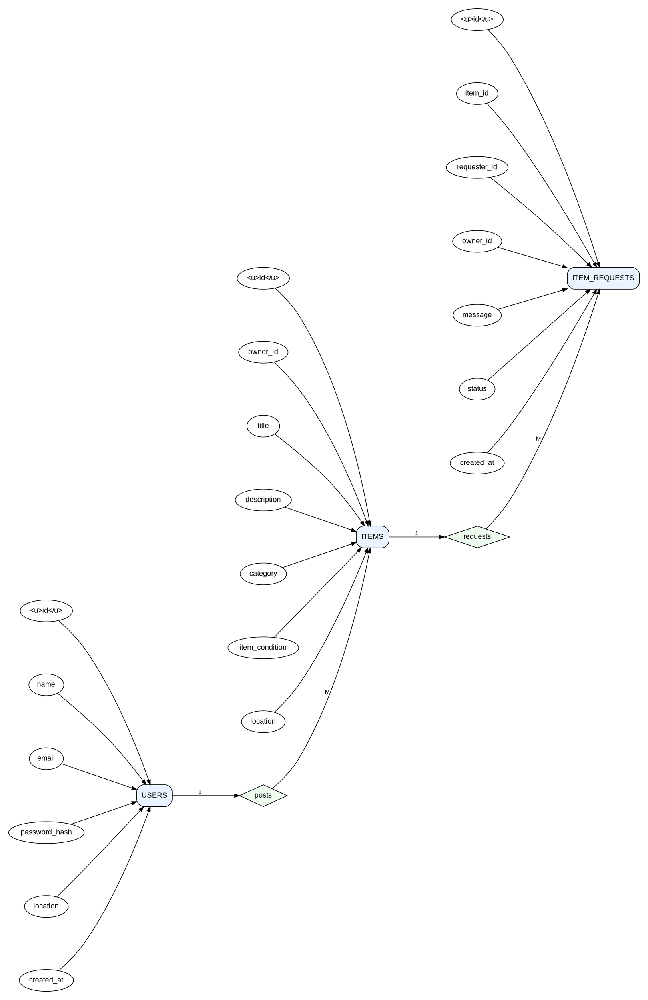

Figure 1: Chen notation ER diagram for the actual user, item, and item request design.

Explanation: The diagram shows that users can post many items and can also send or receive many requests. Each item belongs to an owner and can have multiple request entries. Each request is tied to an item, a requester and an owner.

---

# Chapter 6 – UML Diagrams

## 6.1 Use Case Diagram

```mermaid
flowchart LR
    actor User
    actor Owner
    subgraph System[One More Use]
      UC1[Register account]
      UC2[Log in]
      UC3[Upload item]
      UC4[Analyze object]
      UC5[Browse items]
      UC6[Send request]
      UC7[Accept or reject request]
      UC8[View profile stats]
    end

    User --> UC1
    User --> UC2
    User --> UC3
    User --> UC4
    User --> UC5
    User --> UC6
    User --> UC8
    Owner --> UC7
```

Figure 7: Use case diagram for the implemented workflows.

## 6.2 Class Diagram

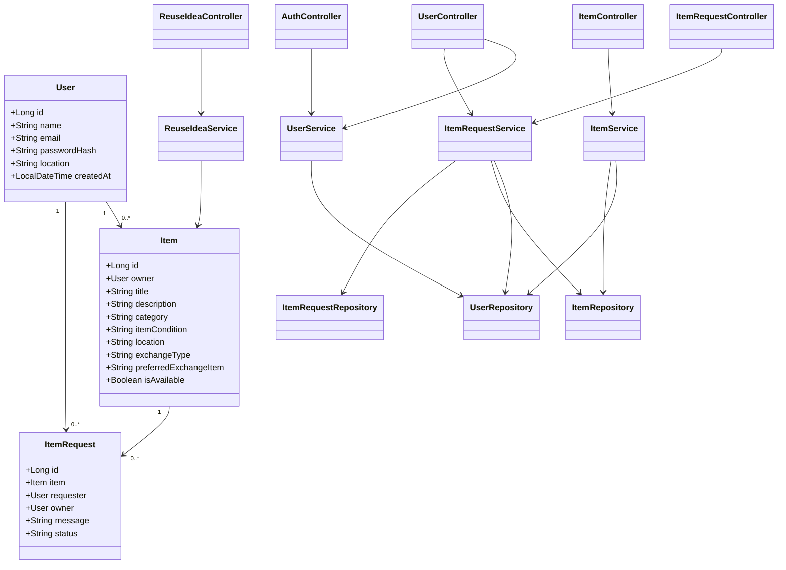

Figure 8: Class diagram based on actual Java entities, services, controllers, and repositories.

## 6.3 Activity Diagram

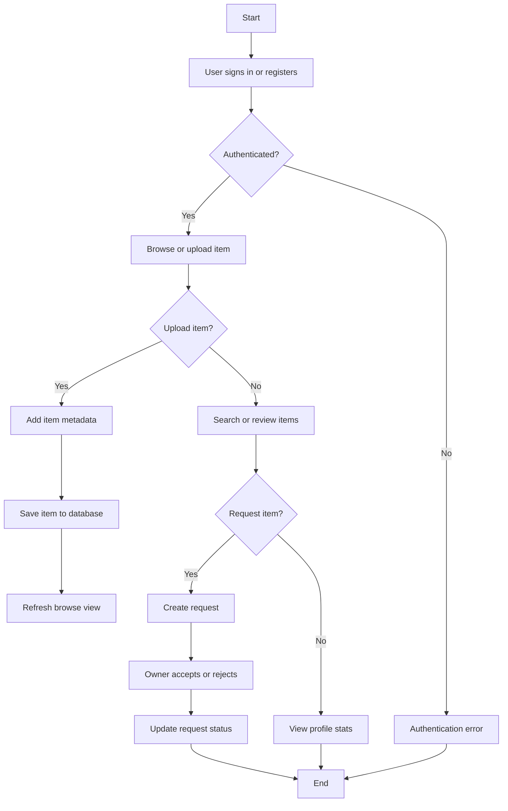

Figure 9: Activity diagram covering the implemented system workflow.

## 6.4 Sequence Diagram – Registration

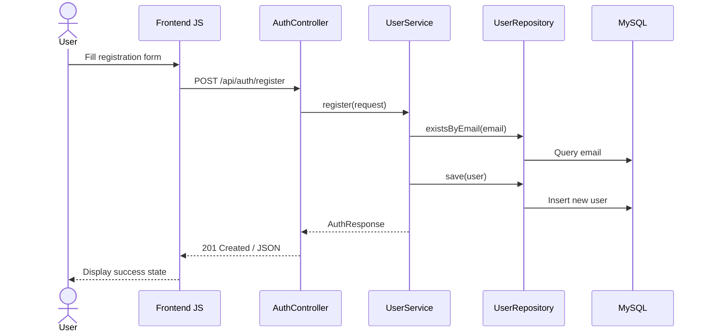

Figure 10: Sequence diagram for registration workflow.

## 6.5 Sequence Diagram – Login

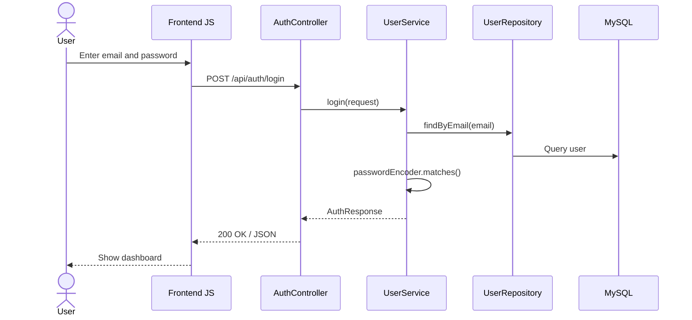

## 6.6 Sequence Diagram – Object Upload and Analysis

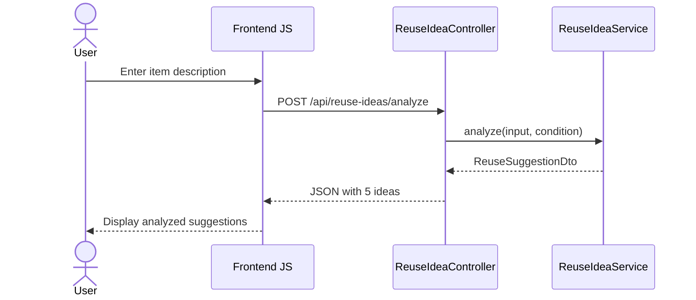

## 6.7 Sequence Diagram – Item Listing

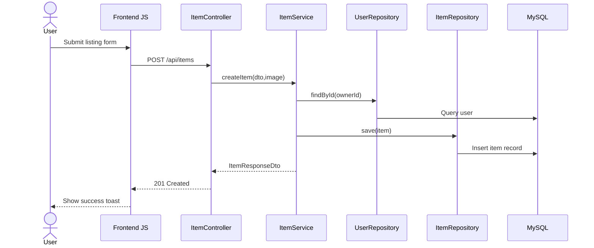

## 6.8 Sequence Diagram – Item Search

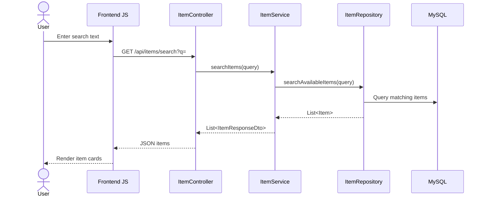

## 6.9 Sequence Diagram – Request Submission and Acceptance

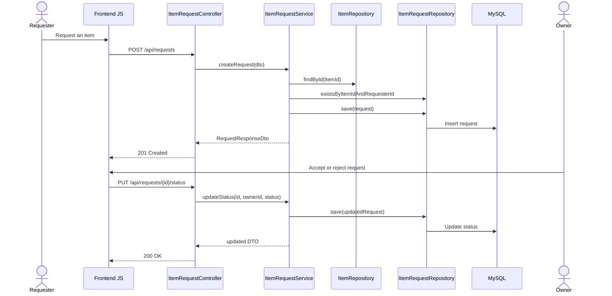

## 6.10 Component Diagram

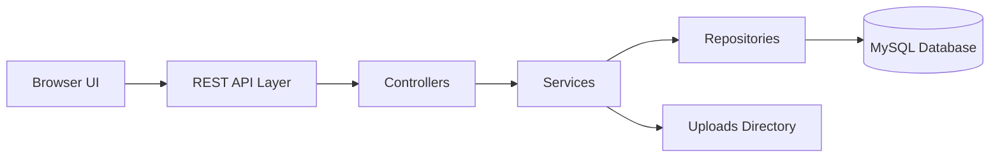

Figure 11: Component diagram showing client, backend, and data access layers.

## 6.11 Deployment Diagram

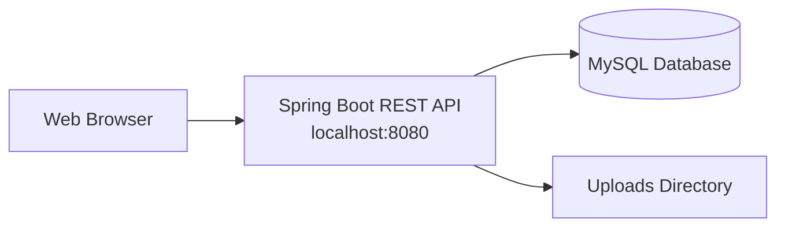

Figure 12: Deployment diagram for the actual local deployment model.

## 6.12 State Machine Diagram

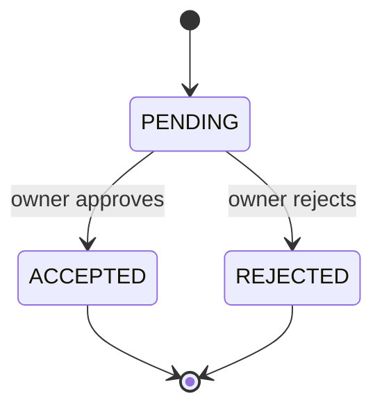

Figure 13: Request lifecycle state machine.

---

# Chapter 7 – Data Flow Diagrams

## 7.1 DFD Level 0 – Context Diagram

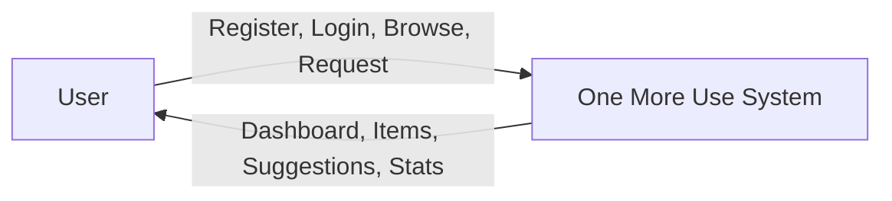

Figure 4: DFD Level 0 context diagram.

## 7.2 DFD Level 1 – Detailed Data Flow

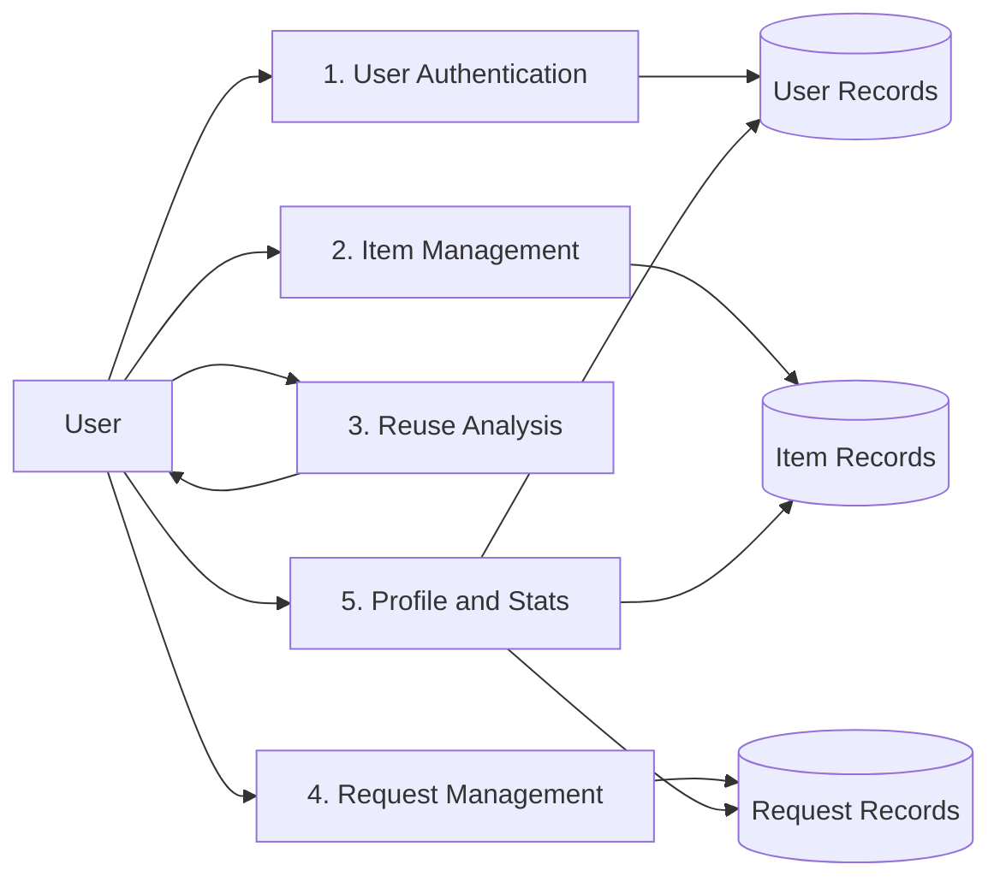

Figure 5: DFD Level 1 showing main system functions.

## 7.3 DFD Level 2 – Item Listing and Request Processing

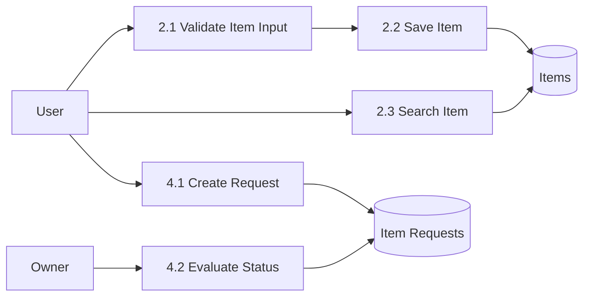

Figure 6: DFD Level 2 decomposition for the item and request workflow.

---

# Chapter 8 – System Architecture Diagrams

## 8.1 High-Level System Architecture

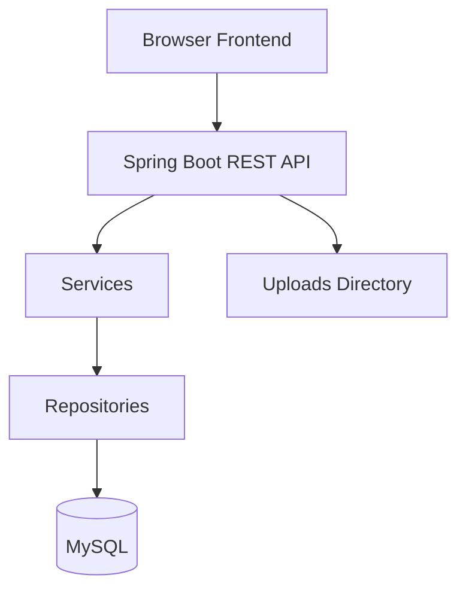

Figure 2: High-level system architecture.

## 8.2 Frontend-Backend-Database Architecture

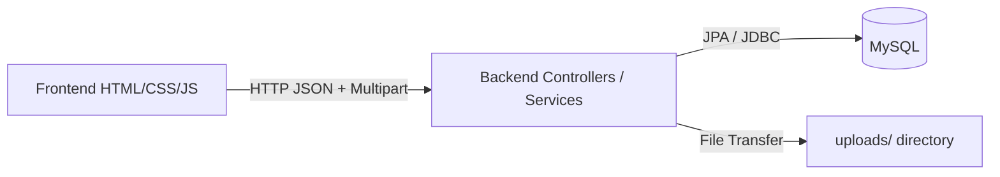

Figure 3: Frontend-backend-database architecture.

## 8.3 Module Hierarchy

- User Interaction Layer
  - Login / registration
  - Item upload
  - Search and browse
  - Request view
  - Profile view
- Business Logic Layer
  - Auth logic
  - Item logic
  - Reuse analysis logic
  - Request logic
- Data Layer
  - Repository layer
  - MySQL persistence
- Storage Layer
  - Local uploads directory

## 8.4 Application Workflow Diagram

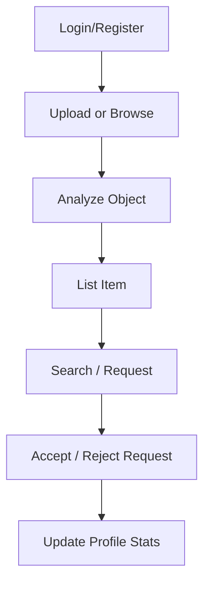

## 8.5 Database Architecture

- `users` domain contains user identity and auth data.
- `items` domain contains item descriptions and listing metadata.
- `item_requests` domain tracks transition from request to accepted/rejected status.

## 8.6 Deployment Architecture

- Browser loads front-end view
- Spring Boot app runs on localhost:8080
- MySQL runs locally and supports persistence
- Images are stored in uploads directory and served via `/uploads/**`

---

# Chapter 9 – Implementation Documentation

## 9.1 Frontend Implementation

The frontend is implemented in `frontend/index.html`, `frontend/css/style.css`, and `frontend/js/app.js`. It provides interactive screens for authentication, dashboard, upload, analysis, search, request handling, and user profile.

### Purpose
To provide a browser interface for interacting with the platform.

### Functionality
- Sign in / sign up
- Upload image and object description
- Generate reuse suggestions
- Post items for free or exchange
- Browse and search available items
- View item details
- Send requests
- Manage incoming/outgoing requests
- View user statistics

### Input
User text, file uploads, form entries, and search terms.

### Processing
The frontend uses the Fetch API to call REST endpoints, handles errors, and updates UI state.

### Output
Rendered HTML screens, toasts, item cards, request rows, and profile metrics.

## 9.2 Backend Implementation

The backend is implemented under `backend/src/main/java/com/onemoreuse`.

### Controllers
- `AuthController`: register/login
- `ItemController`: item retrieval, creation, and search
- `ReuseIdeaController`: object analysis endpoint
- `ItemRequestController`: request creation and status updates
- `UserController`: user profile and stats

### Services
- `UserService`: user registration and login with BCrypt
- `ItemService`: item creation, search, filtering, and image persistence
- `ItemRequestService`: request validation and status lifecycle logic
- `ReuseIdeaService`: rule-based keyword-driven suggestions

### Repositories
- `UserRepository`
- `ItemRepository`
- `ItemRequestRepository`

### Entitites
- `User`
- `Item`
- `ItemRequest`

## 9.3 Database Interaction

The backend interacts with MySQL using JPA. The SQL scripts create and seed data including sample users, items, and requests.

## 9.4 Authentication Implementation

Passwords are stored as BCrypt hashes. The `UserService` verifies passwords using `PasswordEncoder.matches()`. The service also performs a self-healing update for pre-seeded placeholder hashes if the password matches `password123`.

## 9.5 Image Upload Implementation

Items can include an uploaded image. `ItemService` validates MIME type and file size, saves the file under the uploads directory, and stores the relative URL in the database.

## 9.6 Reuse Suggestion Implementation

The reuse engine is implemented in `ReuseIdeaService` using conditional logic on object keywords such as `box`, `chair`, `lamp`, `shelf`, `cycle`, `jar`, and `mixer`. It returns five suggestions and a confidence score. It is a rule-based engine rather than a verified ML model.

## 9.7 Item Management

Supported functions:

- create item
- fetch all available items
- get item by ID
- search items
- list items by user

## 9.8 Community Request Management

Supported functions:

- create request
- fetch incoming and outgoing requests
- accept/reject request
- prevent duplicate/self requests
- user stats calculation

---

# Chapter 10 – API Documentation

## 10.1 API Overview

The backend exposes REST endpoints under `/api`. The frontend uses these endpoints through JavaScript fetch calls.

## 10.2 Endpoint Summary

| Method | URL | Purpose |
|---|---|---|
| POST | `/api/auth/register` | Register a new user |
| POST | `/api/auth/login` | Sign in user |
| GET | `/api/items` | Get all available items |
| GET | `/api/items/{id}` | Get item by ID |
| GET | `/api/items/search` | Search items |
| GET | `/api/items/user/{userId}` | Get items by owner |
| POST | `/api/items` | Create item listing |
| POST | `/api/reuse-ideas/analyze` | Analyze object and return suggestions |
| POST | `/api/requests` | Create item request |
| GET | `/api/requests/incoming/{userId}` | Get incoming requests |
| GET | `/api/requests/outgoing/{userId}` | Get outgoing requests |
| PUT | `/api/requests/{id}/status` | Accept or reject request |
| GET | `/api/users/{id}` | Get user profile |
| GET | `/api/users/{id}/stats` | Get user statistics |

## 10.3 Auth Endpoints

### POST `/api/auth/register`
- Purpose: Register a user
- Request Body:
```json
{
  "name": "Asha Patil",
  "email": "asha@example.com",
  "password": "secret123",
  "location": "Pune"
}
```
- Response: JSON with `success`, `id`, `name`, `email`, `location`, and `token`
- Status Codes: `201 Created`, `400 Bad Request`

### POST `/api/auth/login`
- Purpose: Authenticate existing user
- Request Body:
```json
{
  "email": "priya.kulkarni@gmail.com",
  "password": "password123"
}
```
- Response: `AuthResponse` JSON
- Status Codes: `200 OK`, `401 Unauthorized`

## 10.4 Item Endpoints

### GET `/api/items`
- Purpose: Returns all available items
- Response Body: array of item DTOs
- Status Codes: `200 OK`

### GET `/api/items/{id}`
- Purpose: Returns details for one item
- Response Body: item JSON
- Status Codes: `200 OK`, `404 Not Found`

### GET `/api/items/search?q={keyword}`
- Purpose: Search available items by keyword
- Parameters: `q`
- Response Body: array of matching item JSON objects
- Status Codes: `200 OK`

### GET `/api/items/user/{userId}`
- Purpose: Returns items posted by a user
- Response Body: array of user item DTOs
- Status Codes: `200 OK`

### POST `/api/items`
- Purpose: Create an item listing
- Request: `multipart/form-data` or JSON if using `application/json`
- Multipart fields include `ownerId`, `title`, `description`, `category`, `itemCondition`, `approxSize`, `location`, `exchangeType`, `preferredExchangeItem`, and optional `image`
- Response: created item object
- Status Codes: `201 Created`, `400 Bad Request`

## 10.5 Reuse Idea Endpoint

### POST `/api/reuse-ideas/analyze`
- Purpose: Returns reuse ideas based on object text and condition
- Request Body:
```json
{
  "objectName": "wooden box",
  "condition": "Good — minor wear"
}
```
- Response Body includes `detectedObject`, `category`, `material`, `condition`, `confidenceScore`, and `ideas`
- Status Codes: `200 OK`

## 10.6 Request Endpoints

### POST `/api/requests`
- Purpose: Send a request for an item
- Request Body:
```json
{
  "itemId": 3,
  "requesterId": 1,
  "message": "I am interested in this item"
}
```
- Response Body: `RequestResponseDto`
- Status Codes: `201 Created`, `400 Bad Request`, `409 Conflict`

### GET `/api/requests/incoming/{userId}`
- Purpose: Get all incoming requests for a given owner
- Status Codes: `200 OK`

### GET `/api/requests/outgoing/{userId}`
- Purpose: Get all outgoing requests by a requester
- Status Codes: `200 OK`

### PUT `/api/requests/{id}/status`
- Purpose: Accept or reject a request
- Request Body:
```json
{
  "ownerId": 2,
  "status": "ACCEPTED"
}
```
- Status Codes: `200 OK`, `400 Bad Request`

## 10.7 User Endpoints

### GET `/api/users/{id}`
- Purpose: Return user profile details
- Response body: profile object with name, email, location, createdAt
- Status Codes: `200 OK`, `404 Not Found`

### GET `/api/users/{id}/stats`
- Purpose: Return counts for posted, given, received, and active requests
- Status Codes: `200 OK`

## 10.8 Error Handling

Errors are returned with JSON bodies via a centralized `GlobalExceptionHandler`:

- Validation errors → `400 Bad Request`
- Business rule errors → `400` or `409 Conflict`
- Unexpected errors → `500 Internal Server Error`

---

# Chapter 11 – Software Testing Documentation

## 11.1 Testing Strategy

The repository does not include a dedicated automated test suite. The project was evaluated through repository inspection and implementation review. Runtime tests that require MySQL and the backend service are marked as NOT TESTED or BLOCKED rather than reported as passed.

## 11.2 Unit Testing

Unit testing is not present as a formal structure in the repository. However, validation logic exists in service methods and controller actions.

## 11.3 Integration Testing

Integration between controllers, services, repositories, and MySQL is intended but not validated at runtime in the current environment.

## 11.4 System Testing

System testing of the full browser workflow is not executed because the backend is not guaranteed to be running in the current environment.

## 11.5 Functional Testing

The main functional flows are logically covered by the implementation, but not all were executed. See test table below.

## 11.6 Database Testing

The database schema is implemented in SQL scripts and Java entities, but live database execution is blocked until the MySQL service is running.

## 11.7 API Testing

API calls were reviewed at the controller level, but not executed against the live server in this environment.

## 11.8 UI Testing

Browser UI behavior is represented in the JavaScript app but not runtime-verified in the environment.

## 11.9 Security Testing

Security behavior was reviewed through code inspection. BCrypt is used for password hashing; ownership rules are enforced in service methods.

## 11.10 Test Cases

| Test Case ID | Scenario | Preconditions | Expected Result | Actual Result | Status |
|---|---|---|---|---|---|
| TC-01 | Register valid user | Backend running | User created | Not executed | NOT TESTED |
| TC-02 | Register duplicate email | Existing user | Duplicate email error | Not executed | NOT TESTED |
| TC-03 | Login valid user | Existing database record | Auth succeeds | Not executed | NOT TESTED |
| TC-04 | Login invalid password | Existing user | Unauthorized response | Not executed | NOT TESTED |
| TC-05 | Upload valid item | Logged-in user | Item saved | Not executed | NOT TESTED |
| TC-06 | Upload invalid file type | Logged-in user | Validation error | Not executed | NOT TESTED |
| TC-07 | Search by keyword | Items exist | Matching items returned | Not executed | NOT TESTED |
| TC-08 | Request own item | User is owner | Error returned | Not executed | NOT TESTED |
| TC-09 | Submit valid request | Item available and not owned by requester | Request persisted | Not executed | NOT TESTED |
| TC-10 | Accept request | Owner has pending request | Request status becomes ACCEPTED | Not executed | NOT TESTED |
| TC-11 | Reject request | Owner has pending request | Request status becomes REJECTED | Not executed | NOT TESTED |
| TC-12 | View user stats | User has posts/requests | Correct counts returned | Not executed | NOT TESTED |
| TC-13 | Analyze object | Valid object description | Five ideas returned | Not executed | NOT TESTED |
| TC-14 | Search no results | No matching items | Empty status shown | Not executed | NOT TESTED |

## 11.11 Test Execution Status Summary

| Area | Status |
|---|---|
| MySQL connectivity | BLOCKED |
| Spring Boot startup | BLOCKED |
| End-to-end browser login flow | NOT TESTED |
| API validation | NOT TESTED |
| UI workflow validation | NOT TESTED |

---

# Chapter 12 – Results and Discussion

## 12.1 System Outputs

The system produces the following outputs in the implemented design:

- registered user profile
- item listing in the browse screen
- reuse suggestions for items
- request records with status values
- profile statistics for counts of posted, given, received, and active requests

## 12.2 Screenshots

Figure 14: Screenshot Placeholder – Login Screen (not present in the repository)

Figure 15: Screenshot Placeholder – Browse / Nearby Items Screen (not present in the repository)

Figure 16: Screenshot Placeholder – Request Management Screen (not present in the repository)

No actual screenshots were available in the repository; therefore, the placeholders above are used instead of fabricating UI images.

## 12.3 Module-wise Results

### Authentication Module
- Implemented with registration and login endpoints.
- Password hashing is implemented with BCrypt.

### Item Module
- Item creation, listing, and search are implemented.
- Image upload is handled through form data and file storage.

### Reuse Suggestion Module
- Rule-based reuse suggestions are implemented.
- The engine matches keywords to produce five possible reuse ideas.

### Request Module
- Request creation, retrieval, and status update are implemented.
- Duplicate and self-request prevention is enforced.

### User Statistics Module
- Stats are calculated from item and request records.

## 12.4 Testing Results

The repository supports the claim that the system is structurally implemented, but actual runtime execution cannot be confirmed in this environment without a live MySQL service and running backend.

## 12.5 Known Limitations

- No confirmed AI/vision model exists in the code.
- The system is not production-grade enterprise security hardened.
- LocalStorage-based session persistence is a demo-oriented simplification.
- The backend requires a running MySQL instance and proper credentials.

---

# Chapter 13 – Conclusion and Future Scope

## 13.1 Project Summary

One More Use is a practical reuse platform that demonstrates item listing, request management, and rule-based suggestion logic in a small but complete system. It is suitable as a college project and reflects realistic application boundaries for a student feasibility project.

## 13.2 Objectives Achieved

The following project objectives are evidenced in the code:

- user registration and login
- item posting with metadata and image support
- search and browse capabilities
- request creation and approval flow
- profile stats screen
- rule-based reuse suggestion engine

## 13.3 Contributions

The project contributes a clear example of a layered application built with a Java backend, MySQL data persistence, and a browser-based frontend. It demonstrates sustainable consumption concepts and practical reuse workflows.

## 13.4 Limitations

The current implementation has the following limitations:

- no verified AI recognition engine
- no production-level JWT or secure session model
- no admin moderation or advanced analytics
- local deployment only

## 13.5 Future Enhancements

The following are proposed future enhancements, not implemented features verified in the repository:

- real computer vision or AI-based object recognition
- secure token-based authentication using JWT or OAuth
- improved geolocation-based item discovery
- multi-user messaging/chat system
- admin panel and moderation tools
- cloud storage and deployment architecture

---

# Chapter 14 – Additional Technical Documentation

## 14.1 Installation and Configuration Guide

### Prerequisites

- Java 17+
- Maven
- MySQL 8.0+
- Modern browser

### Setup Steps

1. Start the MySQL service.
2. Open `database_setup.sql` and execute it in MySQL Workbench or MySQL CLI.
3. Edit `backend/src/main/resources/application.properties` with the correct database credentials.
4. Run the backend with Maven.
5. Open `frontend/index.html` in the browser to use the app.

### Notes

- The actual password and DB credentials must be set according to the local system.
- The app is expected to run on port 8080.

## 14.2 User Manual

### How to Use the Application

1. Register a user account.
2. Sign in with email and password.
3. Upload an object or enter a description.
4. Review the generated reuse suggestions.
5. List the item as FREE or EXCHANGE.
6. Browse items and send requests.
7. Accept or reject incoming requests from the Requests screen.
8. View user profile stats.

## 14.3 Developer Guide

### Project Structure

- `backend` – Java Spring Boot project
- `frontend` – HTML/CSS/JS application
- `database_setup.sql` – MySQL database setup script
- `uploads` – image storage directory

### Maintenance Notes

- Keep business rules in service classes.
- Validate user input before persistence.
- Maintain API compatibility between frontend and backend.
- Ensure MySQL is running before app startup.

## 14.4 Maintenance Guide

- Update the database setup script if schema changes occur.
- Validate controller/service compatibility when changing request or response DTOs.
- Review upload size limits and static resource path settings if deployment changes.

## 14.5 Requirements Traceability Matrix

| Requirement ID | Source | Component | Status |
|---|---|---|---|
| FR-01 | Registration logic | `AuthController`, `UserService` | Implemented |
| FR-02 | Email uniqueness | `UserService` | Implemented |
| FR-03 | Password hashing | `UserService` | Implemented |
| FR-04 | Login | `AuthController`, `UserService` | Implemented |
| FR-06 | Item upload | `ItemController`, `ItemService` | Implemented |
| FR-09 | Reuse analysis | `ReuseIdeaController`, `ReuseIdeaService` | Implemented |
| FR-10 | Search | `ItemController`, `ItemRepository` | Implemented |
| FR-12 | Request creation | `ItemRequestController`, `ItemRequestService` | Implemented |
| FR-15 | Accept/reject request | `ItemRequestController`, `ItemRequestService` | Implemented |
| FR-17 | Profile stats | `UserController`, `ItemRequestService` | Implemented |

## 14.6 Complete Data Dictionary

Data dictionary is already included in Chapter 5.

## 14.7 Security Considerations

- BCrypt hashing for passwords
- Validation layer for API input
- Owner-only enforcement for request responses
- CORS policy for frontend access
- Local environment dependency and no external secrets are included in the report

## 14.8 References and Bibliography

The project report is grounded in actual repository files, including:

- `README.md`
- `PROJECT_STATUS.md`
- `database_setup.sql`
- `backend/src/main/java/com/onemoreuse/**`
- `backend/src/main/resources/application.properties`
- `frontend/index.html`
- `frontend/js/app.js`
- `frontend/css/style.css`

No fabricated external bibliography or fake references are used.

## 14.9 Glossary and Abbreviations

The glossary and abbreviations are included earlier in this report.

---

## Final Summary

This report presents a complete technical representation of the actual One More Use repository state. It captures the implemented architecture, database design, APIs, modules, and workflows while clearly identifying which areas remain unverified due to runtime environmental requirements. The document is intentionally careful not to claim features that are not directly supported by the source code.

---

## Appendix A – Implementation Inventory

This appendix summarizes the actual implementation artifacts observed in the project:

- Frontend: `frontend/index.html`, `frontend/css/style.css`, `frontend/js/app.js`
- Backend: Java classes under `backend/src/main/java/com/onemoreuse`
- Configuration: `backend/src/main/resources/application.properties`
- Database scripts: `database_setup.sql`, `backend/src/main/resources/schema.sql`, `backend/src/main/resources/data.sql`
- Entities: `User`, `Item`, `ItemRequest`
- Repositories: `UserRepository`, `ItemRepository`, `ItemRequestRepository`
- Services: `UserService`, `ItemService`, `ItemRequestService`, `ReuseIdeaService`
- Controllers: `AuthController`, `ItemController`, `ItemRequestController`, `ReuseIdeaController`, `UserController`

## Appendix B – Key Implementation Notes

- The reuse suggestion logic is rule-based, not a confirmed ML model.
- Passwords are hashed using BCrypt.
- Item creation supports multipart upload for images.
- The app uses a simple localStorage-based session for demonstration purposes.
- Request lifecycle supports pending, accepted, and rejected statuses.

End of report.
