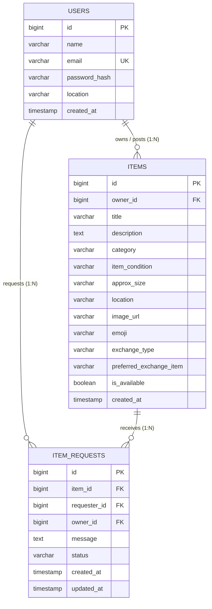

# Database Design Documentation — One More Use

## 1. Database Overview
- **Database Name**: `one_more_use`
- **Database Management System**: MySQL 8.0+
- **Character Encoding**: `utf8mb4` (supports unicode characters and emojis like 🪵, 🪑, 💡)
- **Object-Relational Mapping (ORM)**: Spring Data JPA with Hibernate

---

## 2. Entity-Relationship Diagram (ERD)



---

## 3. Detailed Table Specifications

### A. Table: `users`
Represents registered students and community members.

| Column | Type | Constraints | Description |
|---|---|---|---|
| `id` | `BIGINT` | `PRIMARY KEY`, `AUTO_INCREMENT` | Unique identifier for the user |
| `name` | `VARCHAR(100)` | `NOT NULL` | Full display name (e.g. *Priya Kulkarni*) |
| `email` | `VARCHAR(150)` | `NOT NULL`, `UNIQUE` | User login email |
| `password_hash` | `VARCHAR(255)` | `NOT NULL` | One-way BCrypt cryptographic hash |
| `location` | `VARCHAR(100)` | Default `'Pune'` | User's residential neighborhood |
| `created_at` | `TIMESTAMP` | Default `CURRENT_TIMESTAMP` | Account creation timestamp |

### B. Table: `items`
Represents objects listed for reuse or exchange.

| Column | Type | Constraints | Description |
|---|---|---|---|
| `id` | `BIGINT` | `PRIMARY KEY`, `AUTO_INCREMENT` | Unique item identifier |
| `owner_id` | `BIGINT` | `NOT NULL`, `FOREIGN KEY (users.id)` | ID of the user who owns this item |
| `title` | `VARCHAR(150)` | `NOT NULL` | Item title (e.g. *Old Wooden Box*) |
| `description` | `TEXT` | Nullable | Detailed item condition and measurements |
| `category` | `VARCHAR(100)` | `NOT NULL` | Category (e.g. *Furniture / Storage*) |
| `item_condition`| `VARCHAR(50)` | `NOT NULL` | Condition (*Like new*, *Good*, *Fair*, *Needs repair*) |
| `approx_size` | `VARCHAR(50)` | Default `'Medium'` | Small, Medium, or Large |
| `location` | `VARCHAR(100)` | `NOT NULL` | Neighborhood for physical pickup |
| `image_url` | `VARCHAR(255)` | Nullable | Relative path to uploaded image file |
| `emoji` | `VARCHAR(20)` | Default `'📦'` | Friendly visual fallback icon |
| `exchange_type` | `VARCHAR(50)` | `NOT NULL` | **`FREE`** or **`EXCHANGE`** (strictly no donation wording) |
| `preferred_exchange_item` | `VARCHAR(200)` | Nullable | Desired swap item if `exchange_type = 'EXCHANGE'` |
| `is_available` | `BOOLEAN` | Default `TRUE` | `TRUE` if available, `FALSE` if handed over |
| `created_at` | `TIMESTAMP` | Default `CURRENT_TIMESTAMP` | Post timestamp |

### C. Table: `item_requests`
Represents a formal request submitted by another user to receive or swap an item.

| Column | Type | Constraints | Description |
|---|---|---|---|
| `id` | `BIGINT` | `PRIMARY KEY`, `AUTO_INCREMENT` | Unique request record identifier |
| `item_id` | `BIGINT` | `NOT NULL`, `FOREIGN KEY (items.id)` | Reference to requested item |
| `requester_id`| `BIGINT` | `NOT NULL`, `FOREIGN KEY (users.id)` | ID of user asking for the item |
| `owner_id` | `BIGINT` | `NOT NULL`, `FOREIGN KEY (users.id)` | ID of the item owner |
| `message` | `TEXT` | Nullable | Introductory note or coordination proposal |
| `status` | `VARCHAR(30)` | `NOT NULL`, Default `'PENDING'` | **`PENDING`**, **`ACCEPTED`**, or **`REJECTED`** |
| `created_at` | `TIMESTAMP` | Default `CURRENT_TIMESTAMP` | Time request was submitted |
| `updated_at` | `TIMESTAMP` | `ON UPDATE CURRENT_TIMESTAMP` | Time status changed |

---

## 4. Practical SQL Demonstration Queries

### Query 1: Find all free available items in Kothrud
```sql
SELECT title, category, item_condition, location, created_at 
FROM items 
WHERE is_available = TRUE 
  AND exchange_type = 'FREE' 
  AND location LIKE '%Kothrud%'
ORDER BY created_at DESC;
```

### Query 2: View incoming requests for a user with requester details
```sql
SELECT 
    r.id AS request_id,
    i.title AS item_name,
    u.name AS requester_name,
    u.location AS requester_locality,
    r.message,
    r.status,
    r.created_at
FROM item_requests r
JOIN items i ON r.item_id = i.id
JOIN users u ON r.requester_id = u.id
WHERE r.owner_id = 2
ORDER BY r.created_at DESC;
```

### Query 3: Calculate user statistics for profile dashboard
```sql
SELECT 
    (SELECT COUNT(*) FROM items WHERE owner_id = 1) AS items_posted,
    (SELECT COUNT(*) FROM items WHERE owner_id = 1 AND is_available = FALSE) AS items_given,
    (SELECT COUNT(*) FROM item_requests WHERE requester_id = 1 AND status = 'ACCEPTED') AS items_received,
    (SELECT COUNT(*) FROM item_requests WHERE (owner_id = 1 OR requester_id = 1) AND status = 'PENDING') AS active_requests;
```
